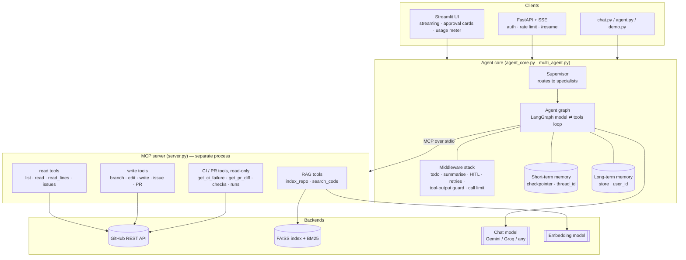
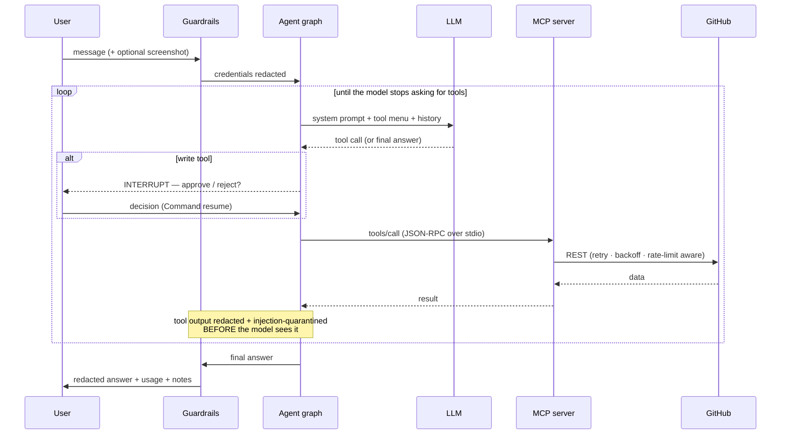
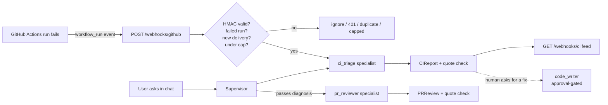

# Architecture

A tool-using GitHub assistant. An LLM reasons; a separate **MCP server** does
the work; everything between them is explicit, bounded and observable.

## 1. System view

**Layers talk only downwards.** The UI knows nothing about GitHub; the tools
know nothing about the UI; the model never touches the network except through
a tool. That is what makes each layer replaceable — the Streamlit UI and the
HTTP API are two front-ends over the *same* `send` / `resume` / `stream_turn`.

## 2. One request, end to end

Key properties:

* **The model only ever *asks*.** Execution is the graph's job, which is where
  approval, sanitising, retries and limits can be enforced in code.
* **Approval is a graph interrupt, not a prompt.** The run is checkpointed and
  frozen; a human decision resumes it. A model cannot talk its way past it.
* **Every tool result is untrusted data** and is scrubbed before it enters the
  model's context (see [SECURITY.md](SECURITY.md)).

## 3. Components

| Module | Responsibility |
|---|---|
| `server.py` | MCP server: 22 tools, thin wrappers that turn errors into model-readable strings |
| `github_client.py` | Resilient REST client: pooled session, retry + backoff + jitter, rate-limit handling, error taxonomy |
| `rag.py` / `retrieval.py` | Index a repo (chunk → embed → FAISS); hybrid search = dense + BM25 fused with RRF |
| `agent_core.py` | `assemble_agent` (graph + middleware), `send` / `resume` / `stream_turn`, usage + guardrail reporting |
| `multi_agent.py` | Supervisor + 5 scoped specialists ("agent as tool"); `ci_triage` and `pr_reviewer` return structured reports |
| `devops_tools.py` | Pure functions behind the CI / PR tools: run overview, one-call CI failure report, PR overview and diff |
| `ci_logs.py` | Shrinks a raw Actions log to the failing step; heuristic failure-category hints |
| `pr_diff.py` | Re-numbers a patch with real new-file line numbers; budgets and orders files (source > tests > docs) |
| `devops_schemas.py` | `CIReport` / `PRReview` (Pydantic) and the quote-grounding check |
| `filetypes.py` | One definition of "noise" files (lockfiles, minified) shared by indexing and PR review |
| `webhook.py` | Pure core of the CI webhook: HMAC check, event parsing, delivery de-dup, per-commit cap, activity log |
| `guardrails.py` | Secret / PII redaction, prompt-injection detection + quarantine (pure functions) |
| `observability.py` | Per-turn tokens, latency, tool calls, estimated cost; structured JSON log lines |
| `memory.py` | Long-term memory tools (`remember` / `recall`) over a LangGraph Store |
| `reflection.py` | Optional critic that fact-checks an answer against tool evidence; fails open |
| `runner.py` | Bridges sync front-ends to the async agent (`AsyncRunner`, `AgentWorker`) |
| `api.py` | FastAPI app: `/chat`, `/chat/stream` (SSE), `/resume`, `/usage`, `/health`, `/webhooks/github`, `/webhooks/ci` |
| `streamlit_app.py` | Web UI |
| `evals/` | Golden set + deterministic checks + LLM-as-judge |
| `config.py` | Validated, fail-fast settings; secrets are `SecretStr` |

## 3a. DevOps agents and the CI webhook

Two **read-only** specialists join the supervisor's team. Neither holds a write
tool; the invariant is tested (`tests/test_devops_agents.py`).

* **Two ways in, one specialist.** A person asks in chat, or the webhook fires
  on a failed run. Both end in the same `ci_triage` agent.
* **Structured, then verified.** A specialist's final answer is a Pydantic
  report. Each evidence quote is checked against what the tools actually
  returned and tagged `[verified]` or `[UNVERIFIED]`.
* **Token-frugal tools.** `get_ci_failure` does the whole investigation in one
  call (failed job, a shrunk log excerpt, history, a flakiness signal) because
  raw logs are megabytes and the free tier allows a handful of calls a minute.
* **Diagnosis never becomes a fix on its own.** Fixing goes through
  `code_writer`, which is still approval-gated. The webhook path is read-only.

## 4. Design decisions and trade-offs

| Decision | Why | Cost / trade-off |
|---|---|---|
| **MCP server as a separate process** | Tools are reusable by any MCP client; the agent and tools evolve independently; crash isolation | An extra process + stdio hop; the server must be launched with the right environment |
| **Middleware chain** over inline logic | Cross-cutting behaviour (retries, limits, approval, guardrails) is added/removed without touching the core loop | Ordering matters and must be understood |
| **`interrupt()` for approvals** | Enforced by the runtime; survives restarts because state is checkpointed | Requires a checkpointer, and callers must implement resume |
| **One owning task per agent (`AgentWorker`)** | The MCP client and SQLite connection are bound to the task that opened them; entering them in one request and using them in another breaks silently | A small bridge layer; jobs run as child tasks so requests still overlap |
| **Hybrid retrieval (BM25 + dense, RRF)** | Code is identifier-heavy: embeddings miss exact names, BM25 misses paraphrases | Rebuilds BM25 per query over the index — fine to ~10⁵ chunks; an inverted index is the next step |
| **Weighted fusion for code-shaped queries** | A lone exact-match otherwise *ties* with dense #1; weighting breaks the tie toward the trusted retriever | A heuristic (`looks_like_identifier`) |
| **Reflection is opt-in and fails open** | It costs a model call and must never turn a good answer into an error | Off by default, so hallucination checking is a deliberate choice |
| **Offline test seam (`assemble_agent`)** | The *real* graph runs against a scripted fake model: tool loop, interrupts, guardrails and streaming are tested for free, deterministically | The fake proves wiring, not model quality — that is the evals' job |
| **Cost shown as an *estimate*** | Gives scale on free tiers where the real bill is $0 | List prices drift; overridable via `MODEL_PRICES_JSON` |
| **Structured output + quote grounding** for DevOps reports | A report is testable and machine-readable, and an invented log line is visible as `[UNVERIFIED]` | Grounding proves a quote exists in the tool output, not that the conclusion drawn from it is right |
| **Webhook is HMAC-authenticated, opt-in, capped** | An endpoint that triggers a model on external events can drain quota or be forged; the signature, the off-by-default switch and the per-commit cap each bound a different risk | The cap and de-dup log are in-memory: they reset on restart and are per-process |
| **Auto-triage but never auto-fix** | Diagnosis is read-only and safe to automate; a model's guessed commit is not | A human is still in the loop for every repair |

## 5. Failure modes the design anticipates

| Failure | Mitigation |
|---|---|
| Provider rate limit (429) | `retry_on_rate_limit` honours the provider's suggested delay |
| Model emits a malformed tool call | `retry_malformed_tool_call` re-prompts with *what was wrong*, not a blind resample |
| Agent loops on one file | Todo checklist + "never repeat a call" instructions + per-turn call cap |
| Runaway cost | `AGENT_RUN_LIMIT`; usage meter makes consumption visible |
| Prompt injection in a repo file | Tool output redacted + quarantined before the model sees it; writes still need approval |
| Secret pasted into chat or echoed back | Redacted on the way in *and* out |
| Hallucinated file / line | Citation-bearing retrieval, eval hallucination guard, optional reflection |
| GitHub 5xx / network blip | Retry with exponential backoff + jitter |
| Context window overflow | Summarisation middleware keeps recent turns verbatim |
| Process restart | Conversation + long-term memory persisted in SQLite |
| Huge CI log or PR diff | `ci_logs.extract_failure` and `pr_diff.render_pr_diff` shrink to the cause / a size budget and say what was omitted |
| Forged or replayed webhook | HMAC signature check; delivery-id de-duplication |
| A commit that keeps failing | Per-commit cap on automatic triage (`CI_AUTO_TRIAGE_MAX_PER_COMMIT`) |
| Checks permission missing on the token | PR overview degrades to `CI: unavailable (...)` instead of failing |

## 6. Scaling notes (what would change in production)

* **State:** swap SQLite for Postgres (`AsyncPostgresSaver` / Postgres store) —
  same interfaces.
* **Concurrency:** run the API with multiple workers behind a load balancer;
  sessions are keyed by `thread_id`, so any worker can serve any thread once
  state is in Postgres.
* **Retrieval:** move the per-repo FAISS file to a managed vector DB; add an
  inverted index for the lexical leg.
* **Rate limiting / auth:** the in-memory limiter and API key are single-node;
  front with an API gateway or Redis-backed limiter.
* **Tracing:** set `LANGSMITH_TRACING=true` to ship full traces; the JSON
  metrics lines are already shaped for a log pipeline.
