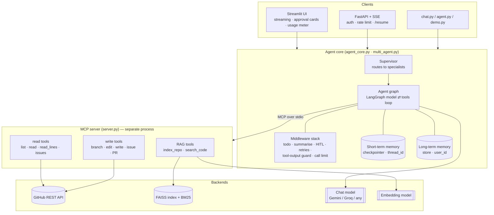
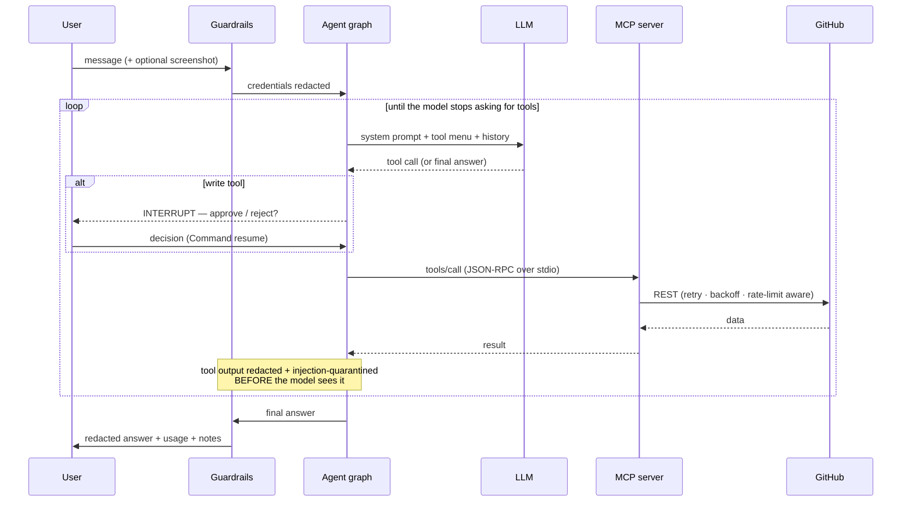

# Architecture

A tool-using GitHub assistant. An LLM reasons; a separate **MCP server** does
the work; everything between them is explicit, bounded and observable.

## 1. System view

**Layers talk only downwards.** The UI knows nothing about GitHub; the tools
know nothing about the UI; the model never touches the network except through
a tool. That is what makes each layer replaceable — the Streamlit UI and the
HTTP API are two front-ends over the *same* `send` / `resume` / `stream_turn`.

## 2. One request, end to end

Key properties:

* **The model only ever *asks*.** Execution is the graph's job, which is where
  approval, sanitising, retries and limits can be enforced in code.
* **Approval is a graph interrupt, not a prompt.** The run is checkpointed and
  frozen; a human decision resumes it. A model cannot talk its way past it.
* **Every tool result is untrusted data** and is scrubbed before it enters the
  model's context (see [SECURITY.md](SECURITY.md)).

## 3. Components

| Module | Responsibility |
|---|---|
| `server.py` | MCP server: 14 tools, thin wrappers that turn errors into model-readable strings |
| `github_client.py` | Resilient REST client: pooled session, retry + backoff + jitter, rate-limit handling, error taxonomy |
| `rag.py` / `retrieval.py` | Index a repo (chunk → embed → FAISS); hybrid search = dense + BM25 fused with RRF |
| `agent_core.py` | `assemble_agent` (graph + middleware), `send` / `resume` / `stream_turn`, usage + guardrail reporting |
| `multi_agent.py` | Supervisor + 3 scoped specialists ("agent as tool") |
| `guardrails.py` | Secret / PII redaction, prompt-injection detection + quarantine (pure functions) |
| `observability.py` | Per-turn tokens, latency, tool calls, estimated cost; structured JSON log lines |
| `memory.py` | Long-term memory tools (`remember` / `recall`) over a LangGraph Store |
| `reflection.py` | Optional critic that fact-checks an answer against tool evidence; fails open |
| `runner.py` | Bridges sync front-ends to the async agent (`AsyncRunner`, `AgentWorker`) |
| `api.py` | FastAPI app: `/chat`, `/chat/stream` (SSE), `/resume`, `/usage`, `/health` |
| `streamlit_app.py` | Web UI |
| `evals/` | Golden set + deterministic checks + LLM-as-judge |
| `config.py` | Validated, fail-fast settings; secrets are `SecretStr` |

## 4. Design decisions and trade-offs

| Decision | Why | Cost / trade-off |
|---|---|---|
| **MCP server as a separate process** | Tools are reusable by any MCP client; the agent and tools evolve independently; crash isolation | An extra process + stdio hop; the server must be launched with the right environment |
| **Middleware chain** over inline logic | Cross-cutting behaviour (retries, limits, approval, guardrails) is added/removed without touching the core loop | Ordering matters and must be understood |
| **`interrupt()` for approvals** | Enforced by the runtime; survives restarts because state is checkpointed | Requires a checkpointer, and callers must implement resume |
| **One owning task per agent (`AgentWorker`)** | The MCP client and SQLite connection are bound to the task that opened them; entering them in one request and using them in another breaks silently | A small bridge layer; jobs run as child tasks so requests still overlap |
| **Hybrid retrieval (BM25 + dense, RRF)** | Code is identifier-heavy: embeddings miss exact names, BM25 misses paraphrases | Rebuilds BM25 per query over the index — fine to ~10⁵ chunks; an inverted index is the next step |
| **Weighted fusion for code-shaped queries** | A lone exact-match otherwise *ties* with dense #1; weighting breaks the tie toward the trusted retriever | A heuristic (`looks_like_identifier`) |
| **Reflection is opt-in and fails open** | It costs a model call and must never turn a good answer into an error | Off by default, so hallucination checking is a deliberate choice |
| **Offline test seam (`assemble_agent`)** | The *real* graph runs against a scripted fake model: tool loop, interrupts, guardrails and streaming are tested for free, deterministically | The fake proves wiring, not model quality — that is the evals' job |
| **Cost shown as an *estimate*** | Gives scale on free tiers where the real bill is $0 | List prices drift; overridable via `MODEL_PRICES_JSON` |

## 5. Failure modes the design anticipates

| Failure | Mitigation |
|---|---|
| Provider rate limit (429) | `retry_on_rate_limit` honours the provider's suggested delay |
| Model emits a malformed tool call | `retry_malformed_tool_call` re-prompts with *what was wrong*, not a blind resample |
| Agent loops on one file | Todo checklist + "never repeat a call" instructions + per-turn call cap |
| Runaway cost | `AGENT_RUN_LIMIT`; usage meter makes consumption visible |
| Prompt injection in a repo file | Tool output redacted + quarantined before the model sees it; writes still need approval |
| Secret pasted into chat or echoed back | Redacted on the way in *and* out |
| Hallucinated file / line | Citation-bearing retrieval, eval hallucination guard, optional reflection |
| GitHub 5xx / network blip | Retry with exponential backoff + jitter |
| Context window overflow | Summarisation middleware keeps recent turns verbatim |
| Process restart | Conversation + long-term memory persisted in SQLite |

## 6. Scaling notes (what would change in production)

* **State:** swap SQLite for Postgres (`AsyncPostgresSaver` / Postgres store) —
  same interfaces.
* **Concurrency:** run the API with multiple workers behind a load balancer;
  sessions are keyed by `thread_id`, so any worker can serve any thread once
  state is in Postgres.
* **Retrieval:** move the per-repo FAISS file to a managed vector DB; add an
  inverted index for the lexical leg.
* **Rate limiting / auth:** the in-memory limiter and API key are single-node;
  front with an API gateway or Redis-backed limiter.
* **Tracing:** set `LANGSMITH_TRACING=true` to ship full traces; the JSON
  metrics lines are already shaped for a log pipeline.
